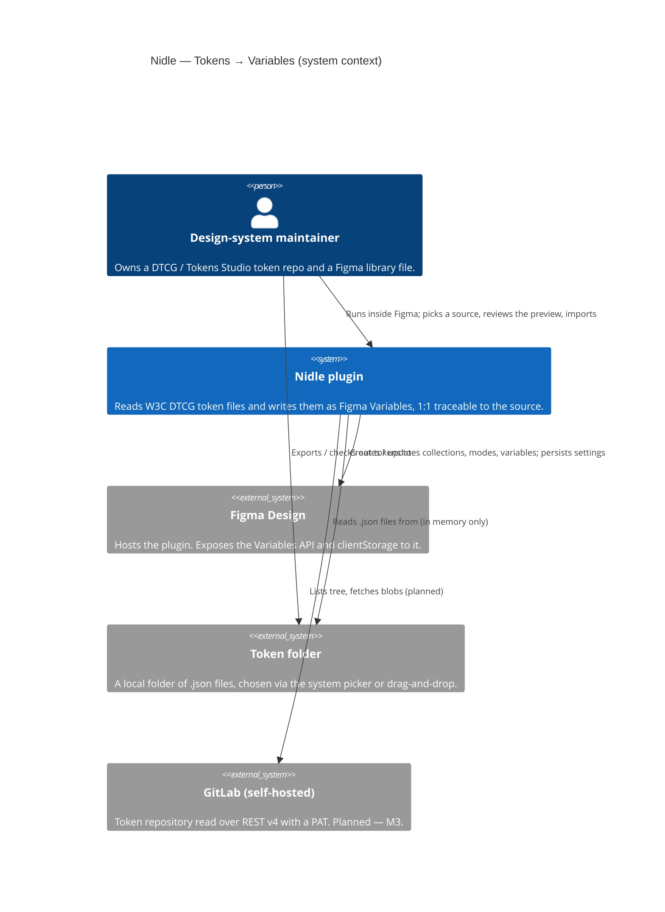

# C1 — System Context

The Nidle plugin seen from outside: who uses it, what it talks to, and
what it deliberately does not touch. Levels: **C1** ·
[C2 Containers](c2-containers.md) · [C3 Components](c3-components.md) ·
[C4 Code](c4-code.md). Detailed module reference:
[../architecture.md](../architecture.md).

## Actors and systems

| Element | Role | Status |
|---------|------|--------|
| Design-system maintainer | The only user. Works in Figma Design, owns the token source. | — |
| **Nidle plugin** | The system. A bridge, not an editor: the repo stays canonical. | shipped (M1, M2, M4, M5) |
| Figma Design | Host. Provides the plugin runtime, `figma.variables.*`, `figma.clientStorage`. | — |
| Token folder | Source today. Read via the browser `File` API; never written to. | shipped |
| GitLab | Second source. Instance URL + PAT (`read_repository`) + project + branch + subfolder. | planned — M3 |

## Boundaries that are decided

- **One direction.** Tokens flow repo → Figma. No round-trip authoring,
  no export to CSS or Style Dictionary (constitution §1).
- **No network in the shipped build.** `manifest.json` declares
  `networkAccess.allowedDomains: ["none"]` until M3 (ADR-0008).
- **No backend, no telemetry.** Settings and, later, GitLab credentials
  live only in Figma `clientStorage` on the user's machine.
- **Formats:** DTCG 2025.10 and Tokens Studio combined exports
  (ADR-0005, ADR-0015). Nothing else.

## Where to go next

- How the system is split into runnable pieces → [C2 Containers](c2-containers.md)
- What the product must do → [../specification.md](../specification.md)
- Why these boundaries → [../constitution.md](../constitution.md), [../decisions/](../decisions/)
