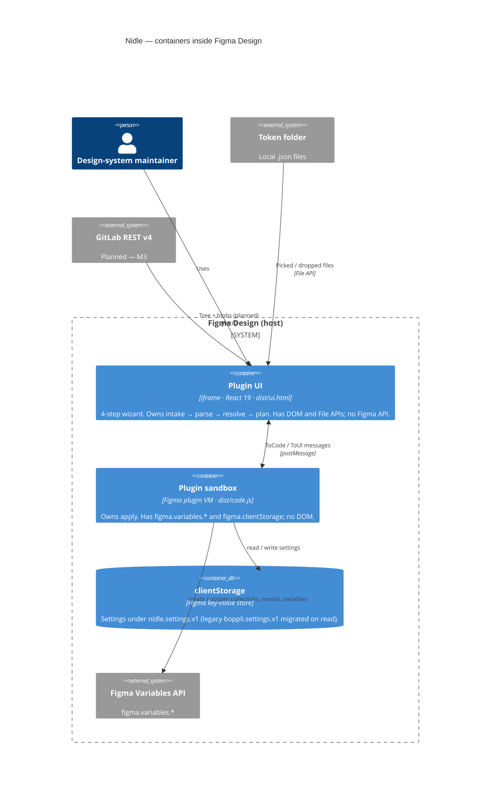

# C2 — Containers

The separately deployed, separately executing pieces of the plugin and
how they talk. Levels: [C1 Context](c1-system-context.md) · **C2** ·
[C3 Components](c3-components.md) · [C4 Code](c4-code.md).

A Figma plugin is two isolated JavaScript contexts with no shared
memory. That split is the container boundary, and the pipeline's stage
split follows it.



## Containers

| Container | Artifact | Runtime | Responsibilities | May touch |
|-----------|----------|---------|------------------|-----------|
| **Plugin UI** | `dist/ui.html` — one file; CSS and the minified JS bundle are inlined at build (ADR-0003) | iframe, React 19, TypeScript | Source picking, parsing, alias resolution, plan computation, preview, settings sheet, progress console | DOM, `File`, drag-and-drop, `fetch` (M3), `parent.postMessage` |
| **Plugin sandbox** | `dist/code.js` — IIFE, ES2017 | Figma plugin VM | Message routing, applying the plan to Figma, settings persistence, window geometry | `figma.variables.*`, `figma.clientStorage`, `figma.ui.postMessage` |
| **clientStorage** | — | Figma-provided | Settings only. The only persistence path in the product. | — |

Both bundles are built by one `esbuild` script (`plugin/build.mjs`) from
two entry points — `src/ui/main.tsx` and `src/code/index.ts`. Code under
`src/shared/` is compiled into whichever bundle imports it and must name
neither `figma.*` nor DOM globals.

## The one coupling point

All UI ↔ sandbox traffic is a typed message union
(`src/code/messages.ts`, mirrored in [../plan.md](../plan.md) §5):

```ts
ToCode = applyPlan(plan) | readSettings | writeSettings(settings) | close
ToUI   = progress(pct, line, tone) | done(created, updated, errors) | error(message) | settings(settings)
```

- **One `applyPlan` carries the whole plan.** The UI computes the full
  `VariablePlan` before any Figma mutation; the sandbox applies it in
  three phases and streams `progress` back (ADR-0001, ADR-0010).
- Every new feature extends this union and nothing else. New variants
  go through the AO ([../agents/ao.md](../agents/ao.md)).

## Stage ownership

```text
 intake  →  parse  →  resolve  →  plan   ║   apply
 ───────────── Plugin UI ─────────────    ║  sandbox
```

The plan is a value: everything left of the bar is a pure function over
JSON and runs in Node for tests. Step 3's preview renders the exact
object the sandbox later consumes — there is no second code path.

## Where to go next

- The modules inside each container → [C3 Components](c3-components.md)
- Build and runtime topology in prose → [../architecture.md](../architecture.md) §2
