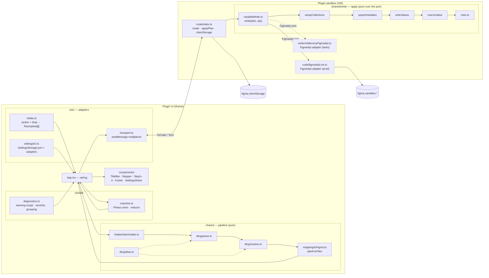

# C3 — Components

The modules inside each container, grouped by pipeline stage, and the
seams between them. Levels: [C1 Context](c1-system-context.md) ·
[C2 Containers](c2-containers.md) · **C3** · [C4 Code](c4-code.md).

Paths are relative to `plugin/src/`. Depth notes and current friction
live in [../architecture.md](../architecture.md) §3 and §7; this page is
the map.

## Plugin UI

### Pipeline stages (`shared/`, no runtime dependencies)

| Stage | Module | Interface | Notes |
|-------|--------|-----------|-------|
| intake | `intake/tokenIntake.ts` | `fromUploads(RawUpload[]) → IntakeResult` | Expands Tokens Studio combined exports into per-set files (ADR-0015), parses, buckets tokens by file. |
| parse | `dtcg/parse.ts` | `parseFiles(UploadedFile[]) → ParseResult` | DTCG tree walk, `$type` inheritance (ADR-0018), value normalisation, composite splitting (ADR-0021), scalar codecs. |
| parse ∧ resolve | `dtcg/alias.ts` | `isAliasValue · aliasPath · isNegatedAlias · negatedAliasOf · aliasName` | The alias grammar, shared by the two stages that read it. |
| resolve | `dtcg/resolve.ts` | `resolveTokens(Token[], mode) → ResolveResult` | Chain walk with cycle and type checks; `keepAlias` keeps the direct hop (ADR-0009). |
| plan | `mapping/toFigma.ts` | `planForFiles(FileTokens[], MappingSettings) → VariablePlan` | Collection routing by folder (ADR-0014), theme → mode detection, mode fill, name emission; also holds the settings schema. |

### State, wiring, views (`ui/`)

| Module | Responsibility |
|--------|---------------|
| `main.tsx` | Composition root: builds the transport and storage adapters, mounts `<App/>`. |
| `App.tsx` | Wiring only: reducer, two effects, memoised `plan` and `diagnostics`, step switch on `phase.kind`. |
| `state/machine.ts` | `Phase` discriminated union, `State`, `Action ⊇ ToUI`, reducer; derives `FileMeta` from `FileTokens`. |
| `state/diagnostics.ts` | `diagnose(parseWarnings, planWarnings, files)` — the one owner of which warnings count, at what severity, grouped how (ADR-0022). |
| `components/` | One module per screen and control; classNames map 1:1 to the design asset. `StepImport` and `Footer` switch exhaustively on `Phase`. |

### Adapters (`ui/io/`)

| Port | Production adapter | Test adapter |
|------|--------------------|--------------|
| `SandboxTransport` | `transport.ts` — sole owner of `window.message`; unwraps `pluginMessage`, fans out | hand-rolled fakes in specs |
| `SettingsStorage` | `postMessageStorage` → sandbox → `clientStorage`; load times out to defaults | `inMemoryStorage` |
| upload path contract | `intake.ts` — picker and drop both yield root-relative paths (FR-106) | fixture `File`s in `appFlow.spec` |

## Plugin sandbox

| Module | Responsibility |
|--------|---------------|
| `code/index.ts` | Message router; `applyPlan` → `write(plan, api)`; settings read/write and legacy-key migration; `showUI` geometry. |
| `code/figmaApiLive.ts` | The production `FigmaApi` adapter. The **only** file that names `figma.variables.*`. |
| `code/messages.ts` | The `ToCode` / `ToUI` union — see [C2](c2-containers.md). |

### Apply stage (`shared/writer/`, pure over the `FigmaApi` port)

| Module | Phase | Responsibility |
|--------|-------|---------------|
| `variableWriter.ts` | — | `write(plan, api, {onProgress}) → WriteReport`; sequences the three phases and owns one monotonic progress scale. |
| `setupCollections.ts` | 1 | Collections and modes; `defaultModeId` invariant; mode-limit fallback. |
| `upsertVariables.ts` | 2 | Index existing variables by `(collection, name)`, create or reuse (ADR-0004). |
| `writeValues.ts` | 3 | Coerce and write each mode value; alias edges; progress ticks with event-loop yields (ADR-0010). |
| `coerceValue.ts` | 3 | `ValueSpec` → a value the port accepts. |
| `color.ts` | 3 | CSS colour string → `FigmaRgba`. Used only here. |
| `inMemoryFigmaApi.ts` | tests | Second adapter for the port; re-implements Figma's object model (see architecture §7.3 for why that is the weakest seam). |

### `FigmaApi` port — seven methods

`listCollections · createCollection · renameMode · addMode · listVariables · createVariable · setValueForMode`.
No node access, no deletion, no publishing. Two adapters make the seam
real and let the whole apply stage run in Node.

## Rules at this level

1. Imports flow forward through the stages. A backwards or
   stage-skipping import is a defect ([../architecture.md](../architecture.md) §10).
2. `shared/` names neither `figma.*` nor DOM globals.
3. A new module earns its file by hiding a decision; one call site in its
   own folder and no test of its own is a candidate for inlining.

## Where to go next

- The data shapes and signatures at each seam → [C4 Code](c4-code.md)
