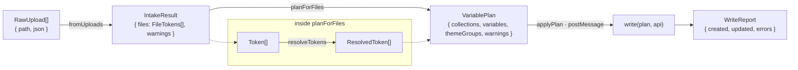
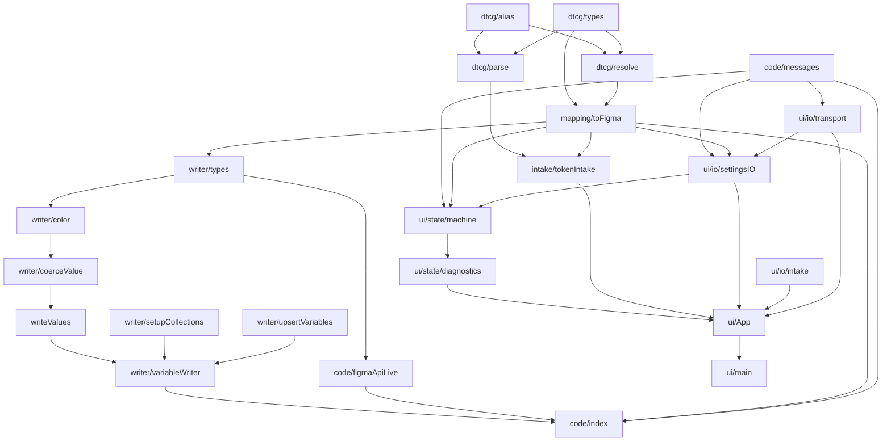

# C4 — Code

The shapes that cross the seams named in [C3](c3-components.md), and the
import graph that keeps the stages in order. Levels:
[C1 Context](c1-system-context.md) · [C2 Containers](c2-containers.md) ·
[C3 Components](c3-components.md) · **C4**.

This page shows signatures and types, not bodies. The code is the
source of truth; when they disagree, fix this page.

## Data flow with the type at every boundary



## Pipeline types (`shared/`)

```ts
// intake / parse
type RawUpload     = { path: string; json: unknown };          // = UploadedFile
type Token         = { name: string; type: DtcgType | null; value: string | number; file: string };
//  type: null  → untyped alias token; the resolver fills it (ADR-0018)
//  value       → literal, or an unresolved alias string "{a.b.c}" / "-{a.b.c}"
type DtcgType      = "color" | "dimension" | "number" | "text";
type ParseWarning  = { file: string; path: string; reason: string;
                       level?: "notice"; summary?: string };   // absent level = the import lost something (ADR-0020)
type FileTokens    = { file: string; tokens: Token[] };
type IntakeResult  = { files: FileTokens[]; warnings: ParseWarning[] };

// resolve
type ResolveMode   = "keepAlias" | "resolve";
type ResolvedValue = { kind: "literal"; value: string | number }
                   | { kind: "alias"; targetName: string };     // the author's direct hop (ADR-0009)
type ResolvedToken = { name: string; type: DtcgType; file: string; value: ResolvedValue };

// plan
type MappingSettings = { refMode: ResolveMode; separator: "slash" | "dot"; updateExisting: boolean };
type StoredSettings  = Partial<MappingSettings>;               // only set keys round-trip
type BaseCollection  = "Primitives" | "Semantic" | "Components";   // folder routing lands here
type CollectionName  = string;                                     // …then theme groups may split: Semantic-Color-Scheme, Semantic-<Dir>
type ValueSpec       = { kind: "literal"; value: string | number }
                     | { kind: "alias"; targetCollection: CollectionName; targetName: string };
type VariableOp      = { collection: CollectionName; name: string; resolvedType: FigmaVarType;
                         values: { mode: string; value: ValueSpec }[];
                         source: { file: string; path: string }; op: "create" | "createOrUpdate" };
type VariablePlan    = { collections: CollectionPlan[]; variables: VariableOp[];
                         themeGroups: ThemeGroup[]; warnings: ParseWarning[] };
```

### Stage signatures

```ts
fromUploads(uploads: RawUpload[]): IntakeResult                              // intake/tokenIntake.ts
parseFiles(files: UploadedFile[]): ParseResult                               // dtcg/parse.ts
expandTokensStudio(f: UploadedFile): UploadedFile[]                          // dtcg/parse.ts
resolveTokens(tokens: Token[], mode: ResolveMode): ResolveResult             // dtcg/resolve.ts
planForFiles(files: FileTokens[], settings: MappingSettings): VariablePlan   // mapping/toFigma.ts
```

## Apply types (`shared/writer/`)

```ts
type FigmaVarType = "COLOR" | "FLOAT" | "STRING";
type FigmaRgba    = { r: number; g: number; b: number; a: number };          // 0–1 floats
type FigmaValue   = FigmaRgba | number | string | { kind: "alias"; variableHandle: VariableHandle };
type WriteError   = { variable: string; reason: string; source: { file: string; path: string } };
type WriteReport  = { created: number; updated: number; errors: WriteError[] };

type CollectionHandle   = { id: string; name: CollectionName };
type VariableHandle     = { id: string; name: string; collectionId: string };
type ExistingCollection = { handle: CollectionHandle; defaultModeId: string; modes: { modeId: string; name: string }[] };

type FigmaApi = {                                     // the port — seven synchronous methods, nothing else
  listCollections(): ExistingCollection[];
  createCollection(name: CollectionName): ExistingCollection;
  renameMode(collectionId: string, modeId: string, name: string): void;
  addMode(collectionId: string, name: string): string;              // → modeId
  listVariables(): { handle: VariableHandle }[];
  createVariable(name: string, collectionId: string, type: FigmaVarType): VariableHandle;
  setValueForMode(variableId: string, modeId: string, value: FigmaValue): void;
};

write(plan: VariablePlan, api: FigmaApi, opts?: { onProgress?: (p: WriteProgress) => void }): Promise<WriteReport>
parseColor(input: string): FigmaRgba | null                                  // writer/color.ts
```

Adapters: `code/figmaApiLive.ts` (production) and
`writer/inMemoryFigmaApi.ts` (tests). Variables are keyed
`` `${collection}::${name}` `` between the three apply phases.

## UI ↔ sandbox contract (`code/messages.ts`)

```ts
type ToCode =
  | { type: "applyPlan"; plan: VariablePlan }
  | { type: "readSettings" }
  | { type: "writeSettings"; settings: StoredSettings }
  | { type: "close" };

type ToUI =
  | { type: "progress"; pct: number; line: string; tone: LogTone }
  | { type: "done"; created: number; updated: number; errors: PlanError[] }
  | { type: "error"; message: string }
  | { type: "settings"; settings: StoredSettings };
```

## UI state (`ui/state/`)

```ts
type Phase =
  | { kind: "source" } | { kind: "sets" } | { kind: "preview" }
  | { kind: "importing"; progress: number }
  | { kind: "done"; result?: ImportResult };                   // error path lands here without a result
type ImportPhase = Extract<Phase, { kind: "importing" | "done" }>;   // what Step 4 renders

type State  = { phase: Phase; files: FileMeta[]; log: LogLine[]; parseWarnings: ParseWarning[];
                settings: MappingSettings; settingsOpen: boolean };
type Action = ToUI                                                     // sandbox messages are actions
            | { type: "filesLoaded"; files: FileTokens[]; parseWarnings: ParseWarning[] }
            | { type: "fileToggled"; path: string }
            | { type: "navigated"; to: 1 | 2 | 3 }
            | { type: "importStarted"; count: number; consoleLines: LogLine[] }
            | { type: "settingsChanged"; patch: StoredSettings }
            | { type: "sheetToggled"; open: boolean }
            | { type: "reset" };

type Diagnostics = { dropped: ParseWarning[]; notices: { kind: string; count: number }[]; consoleLines: LogLine[] };
diagnose(parseWarnings: ParseWarning[], planWarnings: ParseWarning[], files: { path; selected }[]): Diagnostics
```

### Ports on the UI side (`ui/io/`)

```ts
type SandboxTransport = { postCode(msg: ToCode): void; addMessageListener(h: (m: ToUI) => void): () => void };
type SettingsStorage  = { load(): Promise<StoredSettings>; save(s: StoredSettings): Promise<void> };   // load times out to {}
type IntakeFiles      = { uploads: RawUpload[]; warnings: ParseWarning[] };   // unreadable files are warnings
```

## Import graph (must stay acyclic and forward)



Known exception, recorded rather than hidden: `intake/types.ts` imports
`FileTokens` from `mapping/toFigma.ts` — stage 1 depending on stage 4
([../architecture.md](../architecture.md) §7.2).

## Tests at this level

| Seam | Spec | Env |
|------|------|-----|
| `parseFiles`, codecs | `parse.spec.ts` | node |
| `parseColor` | `color.spec.ts` | node |
| `resolveTokens` | `resolve.spec.ts` | node |
| `planForFiles` (fixtures) | `toFigma.spec.ts`, `assetCoverage.spec.ts` | node |
| `write` over the in-memory `FigmaApi` | `variableWriter.spec.ts` | node |
| `SettingsStorage` adapters | `settingsIO.spec.ts` | node |
| reducer, `diagnose`, path contract | `ui/machine.spec.ts`, `ui/diagnostics.spec.ts`, `ui/intake.spec.ts` | node |
| the real wizard, end to end | `ui/appFlow.spec.tsx` | jsdom |
